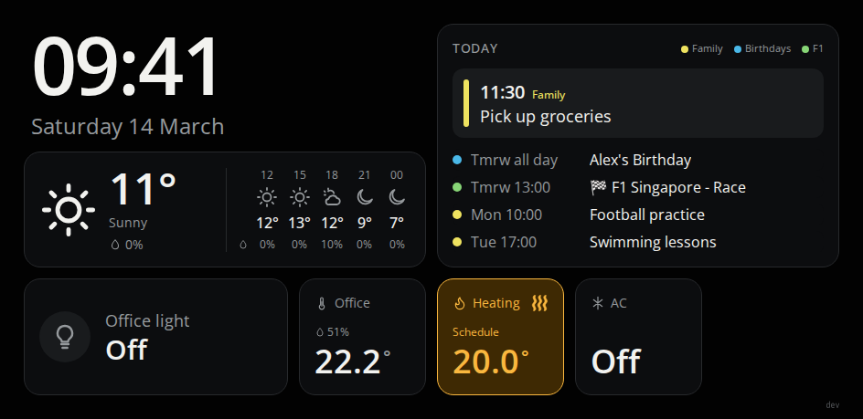

# Home Assistant Wall Panel

[](https://github.com/eledg/ha-wall-panel/actions/workflows/ci.yml)
[](https://github.com/eledg/ha-wall-panel/actions/workflows/release.yml)

A touch-friendly, dark-themed [Home Assistant](https://www.home-assistant.io)
dashboard for Android wall displays. It is a static web app that Home Assistant
serves from `/config/www/` and the display opens full-screen, replacing a
standard Lovelace dashboard. It is built and tested on a
[Shelly Wall Display X2i](docs/display.md); other Android displays with a
modern WebView should work, but check [docs/display.md](docs/display.md) first.



<!-- This is the e2e baseline image, so it stays current when the UI changes (see docs/e2e.md). The data is from the mock Home Assistant (`pnpm dev:mock`). -->

## What it shows

- Clock and date, and weather with an hourly forecast
- Up to three calendars with event details
- A light toggle, room temperature and humidity
- Air-conditioner controls (mode, target, fan, swing)
- Central heating with a demand history
- Night mode, burn-in pixel shift, a disconnected banner and automatic reload
  when a new release is deployed

Your entities, night hours and tile names come from a `config.json` you keep on
the HA box, so every release is generic. See [docs/configuration.md](docs/configuration.md).

## Quick start

1. Download `wall-panel-<tag>.tar.gz` from the
   [latest release](https://github.com/eledg/ha-wall-panel/releases/latest) and
   extract it into `/config/www/<folder>/` on Home Assistant.
2. Copy [`config.example.json`](config.example.json) to
   `/config/www/<folder>.config.json` and fill in your entity IDs.
3. Open `http://<ha-ip>:8123/local/<folder>/index.html` on the display (on the
   Shelly: the dock icon's Home Assistant URL). The URL must end in `index.html`.
4. Set up sign-in and, if you want, automatic updates: see
   [docs/deploy.md](docs/deploy.md).

## Stack

- [Vite](https://vite.dev) + [Preact](https://preactjs.com) + TypeScript (strict)
- pnpm (version pinned in `packageManager`)
- Vitest + happy-dom for tests, ESLint and Prettier for linting and formatting
- Static output only, no SSR

## Development

```sh
pnpm install
pnpm dev:mock          # fake HA, no token or config needed
```

## Commands

| Command          | What it does                                            |
| ---------------- | ------------------------------------------------------- |
| `pnpm dev`       | Start the Vite dev server                               |
| `pnpm dev:mock`  | Dev server against a fake HA, no token or HA needed     |
| `pnpm build`     | Type-check and build to `dist/`                         |
| `pnpm preview`   | Serve the built output locally                          |
| `pnpm test`      | Run tests once (`pnpm test:watch` to watch)             |
| `pnpm test:e2e`  | Playwright against the mock, comparing screenshots      |
| `pnpm lint`      | ESLint (`pnpm lint:fix` to fix)                         |
| `pnpm prettier`  | Check formatting (`pnpm prettier:fix` to fix)           |
| `pnpm typecheck` | Type-check without building                             |
| `pnpm validate`  | Fix formatting and lint, then typecheck, test and build |

Run `pnpm validate` before committing.

## Configuration

The build takes no settings and works from any folder. Your home is described in
a `config.json` beside the app's folder (a deploy replaces the whole folder, so
the file lives next to it): for an app in `/config/www/wall-panel/` that is
`/config/www/wall-panel.config.json`. It lists the entity ID for each tile's
data, optional night-mode hours and optional tile names. If the file is missing
or wrong, the dashboard shows a banner saying what is the matter.

- [docs/configuration.md](docs/configuration.md): the file, its fields and where it goes
- [docs/entities.md](docs/entities.md): each entity key, its domain and what the app reads

Everything under `/local/` is served without login, so never put secrets in the
build or in `config.json`. The display signs in to Home Assistant through the
`trusted_networks` provider, so it needs no token; see
[docs/deploy.md](docs/deploy.md#signing-in-to-ha).

`pnpm dev` connects to your HA with `HA_DEV_URL` and `HA_DEV_TOKEN` from
`.env.local`, and serves your own `config.json` from the repo root (git-ignored;
`HA_DEV_CONFIG` points elsewhere). `pnpm dev:mock` needs neither: it runs the app against a fake HA
(`src/dev/mock/`) with a single Mock overlay for the light and weather
(see [docs/mock.md](docs/mock.md)). Neither is ever part of a build.

## CI and releases

- **CI** (`.github/workflows/ci.yml`) runs prettier, lint, typecheck, test and
  build on every PR and on every push to `main`.
- **Release** (`.github/workflows/release.yml`) runs when CI succeeds on
  `main`. [semantic-release](https://semantic-release.gitbook.io) tags the commit
  with the next version, worked out from the commit messages. When a version
  is created, the workflow also builds the app and publishes a GitHub Release with
  `wall-panel-<tag>.tar.gz` and its `.sha256` attached. The archive has
  `index.html` and `version.json` at its root.

Deployment to Home Assistant is described in [docs/deploy.md](docs/deploy.md).

## License

[MIT](LICENSE). To report a security problem, see [SECURITY.md](SECURITY.md).

## Contributing

Contributions are welcome; see [CONTRIBUTING.md](CONTRIBUTING.md). Commit
messages and PR titles drive versioning, so they must follow the convention
there.

## Docs

- [docs/configuration.md](docs/configuration.md): the `config.json` file
- [docs/entities.md](docs/entities.md): the entities the app uses and what it reads
- [docs/deploy.md](docs/deploy.md): deploying to Home Assistant, signing in, rolling back
- [docs/display.md](docs/display.md): findings from testing on the Shelly Wall Display X2i
- [docs/design.md](docs/design.md): the UI rules and shared pieces
- [docs/design-notes.md](docs/design-notes.md): why it is built this way, and open questions
- [docs/mock.md](docs/mock.md): the mock HA and its overlay
- [docs/e2e.md](docs/e2e.md) and [docs/performance.md](docs/performance.md): screenshot tests and the performance budget
- [docs/structure.md](docs/structure.md): how `src/` is organised and the import rules
